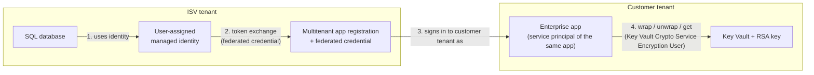

# Cross-tenant CMK TDE – access and permissions summary

This file lists the Microsoft Entra ID and Azure access needed in each tenant to set up cross-tenant customer-managed key (CMK) TDE for an Azure SQL database (including Hyperscale), and explains why each one is needed.

For the step-by-step procedure, see [Cross-Tenant-CMK-TDE-Guide.md](./Cross-Tenant-CMK-TDE-Guide.md).

---

## 1. Tenants and identities

| Tenant | Tenant ID | Owns |
|---|---|---|
| **ISV / service provider** (SQL side) | `<tenant id of ISV>` | SQL server `<SQL server name>`, database `<database name>`, managed identity `<managed identity name>`, app registration `<multitenant app name>` |
| **Customer** (key side) | `<tenant id of customer>` | Key Vault `<Key Vault name>`, key `<key name>`, enterprise app (service principal) for `<multitenant app name>` |

### How access flows at runtime

1. The database uses the **managed identity** attached to it.
2. The **federated credential** on the app trusts that managed identity, so the managed identity can obtain a token for the app.
3. Because the app is **multitenant** and has a **service principal** in the customer tenant, that token is valid in the customer tenant.
4. The service principal holds a **Key Vault role**, so SQL can wrap and unwrap its database encryption key with the customer's key.

**No user needs access in the other tenant.** The only identity that crosses the tenant boundary is the app, through its service principal in the customer tenant. Neither side shares a secret or certificate.

---

## 2. Workload (non-human) identities – what each one needs

| Identity | Tenant | Required configuration / access | Why |
|---|---|---|---|
| **User-assigned managed identity** `<managed identity name>` | ISV | Attached to the SQL database (or server). No Azure role assignments are needed. | It is the identity the SQL resource authenticates as. Its **object (principal) ID** is the *subject* of the federated credential. Cross-tenant CMK supports **only user-assigned** managed identities, not system-assigned ones. |
| **App registration** `<multitenant app name>` (client ID `<client id of multitenant app>`) | ISV | Supported account types = **Multitenant**. **Federated credential**: issuer `https://login.microsoftonline.com/<tenant id of ISV>/v2.0`, subject = the managed identity's principal ID, audience `api://AzureADTokenExchange`. **No API permissions** needed. **Redirect URI** (for example `https://portal.azure.com`) only if you install it through the admin-consent URL. | Multitenant lets the app have a service principal in the customer tenant. The federated credential lets the managed identity act as the app without secrets. Without a redirect URI, the admin-consent URL fails with `AADSTS500113`. |
| **Enterprise app / service principal** of `<multitenant app name>` | Customer | **Key Vault Crypto Service Encryption User** on `<Key Vault name>` (RBAC model), or access policy **Get, Wrap Key, Unwrap Key** (access-policy model). | This is the identity that actually calls Key Vault. *Get* reads the key; *Wrap/Unwrap* encrypt and decrypt the database encryption key. |
| **SQL database** `<database name>` (or server `<SQL server name>`) | ISV | Identity = the managed identity, `federatedClientId` = the app's client ID, encryption protector = the full versioned key URL. | Tells SQL which identity and which app to use when it calls the customer's Key Vault. |

---

## 3. Human / admin access – ISV tenant

| # | Task | Access needed | Type | Scope | Why |
|---|---|---|---|---|---|
| I-1 | Create the managed identity | **Managed Identity Contributor** (or Contributor) | Azure RBAC | `<SQL resource group>` | Needs `Microsoft.ManagedIdentity/userAssignedIdentities/write`. |
| I-2 | Create the multitenant app registration | **Application Developer** (minimum), or *Users can register applications = Yes* | Entra directory role | ISV tenant | Creates the app and makes the creator its owner. Needed if tenant settings block normal users from registering apps. |
| I-3 | Add the federated credential and redirect URI, set the app to multitenant | **Owner of the app registration**, or Cloud Application Administrator / Application Administrator | App ownership or Entra directory role | `<multitenant app name>` | Changing an app's credentials and authentication settings requires owning or administering that app. |
| I-4 | Attach the managed identity and federated client ID to the SQL database/server | **Contributor**, or **SQL Server Contributor** + **Managed Identity Operator** | Azure RBAC | `<SQL resource group>` (or the server + the managed identity) | Needs `Microsoft.Sql/servers/write` / `databases/write`, plus `Microsoft.ManagedIdentity/userAssignedIdentities/*/assign/action` to attach the managed identity. Without this you get `Forbidden` / `AuthorizationFailed … Microsoft.Sql/servers/write`. |
| I-5 | Register the key and set the TDE protector | Same as I-4 | Azure RBAC | `<SQL resource group>` | Writes to `servers/keys`, `servers/encryptionProtector` or the database's `encryptionProtector`. |
| I-6 *(server-level only)* | Configure the geo-DR partner `<partner server name>` | **Contributor** (or as I-4) | Azure RBAC | `<partner resource group>` | Azure requires every geo-replication or failover-group partner to reach the key before the primary's protector changes (`ManagementServiceMissingServerIdentityForGeoDr`). **Not needed with database-level CMK** on a non-replicated database. |
| I-7 | Verify | **Reader** (Contributor already covers it) | Azure RBAC | `<SQL resource group>` | Reads the database or server encryption settings. |

**Recommended minimum for the person running the script:** **Contributor on the SQL resource group** (covers I-1, I-4, I-5 and I-7) **plus Owner of the app registration** (I-3).

---

## 4. Human / admin access – customer tenant

| # | Task | Access needed | Type | Scope | Why |
|---|---|---|---|---|---|
| C-1 | Install the ISV app (create its service principal) with `az ad sp create --id "<client id of multitenant app>"` | **Application Developer** (minimum), or Cloud Application Administrator / Application Administrator | Entra directory role | Customer tenant | Creating a service principal for another tenant's app is a directory write. |
| C-1 (alt) | Install the app through the **admin-consent URL** | **Cloud Application Administrator**, **Application Administrator** or **Global Administrator** | Entra directory role | Customer tenant | Granting tenant-wide admin consent requires an admin role. It also needs a redirect URI on the app (I-3). |
| C-2 | Create the Key Vault and enable **soft delete + purge protection**; configure the firewall | **Key Vault Contributor** (or Contributor) | Azure RBAC (management plane) | `<Key Vault resource group>` / vault | Needs `Microsoft.KeyVault/vaults/write`. SQL rejects keys from vaults without purge protection (`SecurityInvalidAzureKeyVaultRecoveryLevel`). |
| C-3 | Create the RSA key | **Key Vault Crypto Officer** | Azure RBAC (data plane) | `<Key Vault name>` | Management-plane roles (Contributor, Key Vault Contributor) **cannot** create keys in an RBAC-model vault. |
| C-4 | Grant the ISV app's service principal **Key Vault Crypto Service Encryption User** | **Owner**, **User Access Administrator** or **Role Based Access Control Administrator** | Azure RBAC | `<Key Vault name>` | Creating role assignments needs `Microsoft.Authorization/roleAssignments/write`. Contributor and Key Vault Contributor do **not** include it. |
| C-5 | Share the key identifier with the ISV | Key Vault Reader or Key Vault Crypto Officer | Azure RBAC | `<Key Vault name>` | Reads the full versioned key URL. |

---

## 5. Key Vault requirements (configuration, not access)

| Requirement | Why |
|---|---|
| **Soft delete** enabled | Required by Azure SQL TDE. It is on by default for new vaults. |
| **Purge protection** enabled (cannot be undone) | Required by Azure SQL TDE so the key can't be permanently deleted while databases depend on it. |
| Firewall: **Allow trusted Microsoft services**, or a private endpoint | SQL must reach the vault over the network. |
| **RSA / RSA-HSM** key, 2048 or 3072 bits, enabled and not expired | Supported TDE protector key types. |
| Use the **full versioned key URL** (`https://<Key Vault name>.vault.azure.net/keys/<key name>/<key version>`) | Passing only the version is invalid. |

---

## 6. Common pitfalls

| Observation | Impact | Workaround |
|---|---|---|
| The signed-in account is a **guest** in the ISV tenant, or Graph access is restricted | Az PowerShell calls to Microsoft Graph (`Get-AzADApplication`, `New-AzADApplication`, `New-AzADAppFederatedCredential`) fail with `Insufficient privileges`, even when the account owns the app. | Do the Entra steps (app, redirect URI, federated credential) in the **portal**. Pass `-AppId`/`-AppObjectId`, `-SkipFederatedCredential` and `-CustomerSpObjectId` to the script to skip Graph calls. |
| A guest has a **different object ID in each tenant** | Role assignments made to the wrong object do nothing. | Assign roles to the object ID shown in the `AuthorizationFailed` error. |
| **Application Developer** is an Entra directory role, not a subscription role | Assigning it on the subscription has no effect. | Assign it under **Entra ID → Roles and administrators**. |
| New role assignments don't apply to an existing session | `AuthorizationFailed` can continue after the role is granted. | `Disconnect-AzAccount; Clear-AzContext -Force`, then sign in again. |
| The SQL server has a geo-DR partner | A server-level protector change also requires the partner server. | Use **database-level** CMK (`-DatabaseLevel`), or pass `-PartnerServerName`. |
| `az ad sp create` returns `… already in use` | The service principal already exists (no error). | `az ad sp show --id "<client id of multitenant app>"` to get its object ID. |

---

## 7. Quick checklist

**ISV tenant**
- [ ] Contributor on the SQL resource group (plus the partner resource group for server-level CMK)
- [ ] Application Developer role (if app registration is restricted), or an existing app you own
- [ ] Owner of the multitenant app registration
- [ ] App is multitenant, has a federated credential for the managed identity's principal ID, and (optionally) a redirect URI

**Customer tenant**
- [ ] Application Developer / Cloud Application Administrator, to create the service principal
- [ ] Key Vault Contributor, to create the vault and enable purge protection
- [ ] Key Vault Crypto Officer, to create the key
- [ ] Owner / User Access Administrator / RBAC Administrator on the vault, to grant the role
- [ ] Service principal of the multitenant app has **Key Vault Crypto Service Encryption User** on the vault
