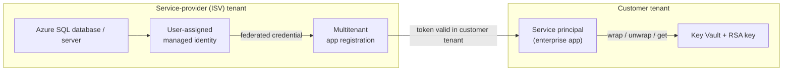

# Cross-tenant customer-managed key (CMK) TDE for Azure SQL Database

PowerShell automation and documentation for configuring **Transparent Data Encryption (TDE) with a customer-managed key stored in a Key Vault in a different Microsoft Entra tenant**. It covers Azure SQL Database, including **Hyperscale**.

The approach follows Microsoft's guidance: [Cross-Tenant Customer-Managed Keys with Transparent Data Encryption](https://learn.microsoft.com/en-us/azure/azure-sql/database/transparent-data-encryption-byok-cross-tenant?view=azuresql). It uses:

- a **user-assigned managed identity** on the SQL resource (service-provider / ISV tenant),
- a **multitenant Entra app registration** with a **federated identity credential** that trusts that managed identity,
- the app's **service principal** in the customer tenant, granted **Key Vault Crypto Service Encryption User** on the customer's vault.

No secrets or certificates are exchanged between tenants.

For a **fresh Hyperscale database-level setup using customer-owned Managed HSM**, see the [Managed HSM runbook](./Hyperscale-Cross-Tenant-Managed-HSM-Fresh-Setup.md). It includes portal steps and optional step-by-step Bash/Azure CLI and Azure PowerShell commands, with each operator working only in their own tenant and **no guest-user access in either direction**. The existing PowerShell automation below targets the Key Vault workflow; it is not the Managed HSM deployment script.



## Repository contents

| File | Description |
|---|---|
| [Hyperscale-Cross-Tenant-Managed-HSM-Fresh-Setup.md](./Hyperscale-Cross-Tenant-Managed-HSM-Fresh-Setup.md) | Fresh Hyperscale database-level CMK setup with Managed HSM, tenant-separated portal steps, Bash and PowerShell alternatives, verification, and operations. |
| [Set-CrossTenantCmkTde.ps1](./Set-CrossTenantCmkTde.ps1) | Script that configures the ISV and customer sides and applies the TDE protector at **server** or **database** level. |
| [Cross-Tenant-CMK-TDE-Guide.md](./Cross-Tenant-CMK-TDE-Guide.md) | Step-by-step guide. Marks which steps are done in the **portal** and which by the **script**, and includes verification and troubleshooting. |
| [Cross-Tenant-CMK-Access-Summary.md](./Cross-Tenant-CMK-Access-Summary.md) | Entra ID roles, Azure RBAC roles and app configuration needed in each tenant, and **why**. |

## Script features

- **Three phases**, runnable separately by different people or together with `-Phase All`:
  - `IsvPrepare` – creates the managed identity, the multitenant app and the federated credential (ISV tenant).
  - `CustomerSetup` – creates the service principal, the Key Vault (soft delete + purge protection), the RSA key and the role assignment (customer tenant).
  - `IsvConfigure` – attaches the identity and federated client ID to SQL and sets the TDE protector (ISV tenant).
- **`-DatabaseLevel`** – applies the CMK to a single database only; the server protector is left unchanged.
- **`-PartnerServerName`** – configures a geo-replication / failover-group partner server first, as Azure requires for server-level changes.
- **Graph-free mode** for restricted or guest accounts: `-AppId`/`-AppObjectId`, `-SkipFederatedCredential` and `-CustomerSpObjectId` skip all Microsoft Graph calls, so the Entra steps can be done in the portal.
- Uses **direct Azure Resource Manager calls** for the SQL changes, so failures show the full error code (`AuthorizationFailed`, `RequestDisallowedByPolicy`, …) instead of a bare `Forbidden`.
- Checks that `-KeyId` is a full, versioned key URL.

## Quick start

Prerequisites: PowerShell 7+, and the `Az` modules (the script installs any that are missing). For the permissions needed in each tenant, see [the access summary](./Cross-Tenant-CMK-Access-Summary.md).

**Database-level CMK** (after the portal steps in the guide are complete):

```powershell
.\Set-CrossTenantCmkTde.ps1 -Phase IsvConfigure -DatabaseLevel `
  -IsvTenantId "<tenant id of ISV>" -IsvSubscriptionId "<subscription id of ISV>" `
  -SqlServerName "<SQL server name>" -SqlResourceGroup "<SQL resource group>" `
  -UamiName "<managed identity name>" -DatabaseName "<database name>" `
  -AppId "<client id of multitenant app>" `
  -KeyId "https://<Key Vault name>.vault.azure.net/keys/<key name>/<key version>"
```

**End-to-end** (when the signed-in accounts can call Microsoft Graph in both tenants):

```powershell
.\Set-CrossTenantCmkTde.ps1 -Phase All `
  -IsvTenantId "<tenant id of ISV>" -IsvSubscriptionId "<subscription id of ISV>" `
  -SqlServerName "<SQL server name>" -SqlResourceGroup "<SQL resource group>" `
  -CustomerTenantId "<tenant id of customer>" -CustomerSubscriptionId "<subscription id of customer>" `
  -KeyVaultName "<Key Vault name>" -KeyVaultResourceGroup "<Key Vault resource group>"
```

The script writes hand-off values (app ID, key ID) to `cross-tenant-cmk.state.json` next to it. That file is excluded by `.gitignore`.

## Placeholders

Replace every `<…>` value with your own. No real tenant, subscription, resource or database names are included in this repository.

| Placeholder | Meaning |
|---|---|
| `<tenant id of ISV>` / `<subscription id of ISV>` | Tenant and subscription that host the Azure SQL server |
| `<tenant id of customer>` / `<subscription id of customer>` | Tenant and subscription that host the Key Vault |
| `<multitenant app name>` / `<client id of multitenant app>` | Name and Application (client) ID of the multitenant app registration |
| `<managed identity name>` | User-assigned managed identity attached to the SQL resource |
| `<federated credential name>` | Name of the federated credential on the app |
| `<SQL server name>` / `<SQL resource group>` / `<database name>` | Logical SQL server, its resource group, and the target database |
| `<partner server name>` / `<partner resource group>` | Geo-replication / failover-group partner server (server-level CMK only) |
| `<Key Vault name>` / `<Key Vault resource group>` | Customer Key Vault and its resource group |
| `<key name>` / `<key version>` | RSA key in the vault and its version |

## Notes

- Cross-tenant CMK supports **only user-assigned** managed identities.
- The Key Vault must have **soft delete and purge protection** enabled. Purge protection is irreversible.
- Losing access to the key makes the database **inaccessible**. Monitor key expiry and keep previous key versions for restores.
- Test in a non-production environment first.

## Disclaimer

This sample is provided as-is, without warranty. Review it and adapt it to your organization's security and change-management requirements before use.
